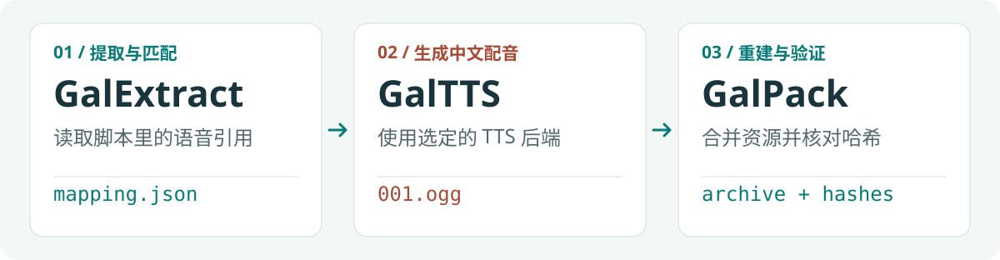

# GalSkill

**按用户需求解包、处理与封包 GalGame 各类资源，按需生成中文配音。**

目前维护中文版本。

四个可独立使用、按任务衔接的技能。由 AI 助手分析游戏引擎与格式，配合工具处理脚本、图像、音频、视频、字体等资源，以原样基线、资源路径、格式检查与哈希校验衔接解包和封包。GalTTS 专注语音生成，仅在需要配音时参与。

主线是解包、按需修改资源、封包与验证。需要中文配音时使用 GalTTS；遇到未知格式或加载障碍时使用 GalReverse，验证方法后返回当前任务。

<picture>
  <source media="(max-width: 600px)" srcset="assets/readme/workflow-zh-mobile.svg">
  
</picture>

例如，安装后可以这样开始：

```text
使用 $galgame-resource-extract，检查 D:/Games/Example 的引擎，定位脚本与图像所在归档，
将需要修改的归档原样解包到 D:/GalWork/Example，并记录格式、资源路径与后续封包要求。
```

## 按需求选择技能

| Skill | 用途 | 主要交付物 |
| --- | --- | --- |
| [GalExtract](GalgameResourceExtract/SKILL.md) | 识别引擎、解包各类资源；需要时解析脚本并建立对白与语音关联 | 原样资源根目录、来源与格式记录；按需提供解析结果或映射 |
| [GalTTS](GalgameTextToSpeech/SKILL.md) | 使用选定的 TTS 后端生成中文语音，保留支持的源音频属性，支持停止和续跑 | 替换语音、审计结果、资源交接清单 |
| [GalPack](GalgameResourcePack/SKILL.md) | 合并原样资源与各类修改资源，完整重建或制作游戏支持的补丁归档 | 新归档、提取后的资源比对报告 |
| [GalReverse](GalgameReverse/SKILL.md) | 分析未知格式、加密、字节码、编码字体或资源加载障碍 | 格式证据、解析/修改方案及验证记录 |

这是一套供 AI 助手执行的工作流程与辅助脚本，实际解包、解析和封包能力取决于目标格式及可用工具；不包含通用的游戏脚本解析器或预装 TTS 模型。你也可以只使用其中一个技能。

## 快速开始

### 1. 安装所需技能

准备 Node.js 22.20+（含 `npx`）与 Git，即可通过 [skills CLI](https://github.com/vercel-labs/skills) 安装。例如，将四个技能全局安装给 Codex：

```bash
npx skills add CbShuiMu/Galgear-GalgameReverse-Skill --skill '*' -a codex -g
```

只安装一个技能时，指定其 `name`：

```bash
npx skills add CbShuiMu/Galgear-GalgameReverse-Skill --skill galgame-resource-pack -a codex -g
```

去掉 `--skill` 参数可交互选择技能；`-a codex` 指定助手，`-g` 表示用户全局安装，省略则安装到当前项目。其他助手可改用 CLI 支持的标识或通过交互选择。仅列出仓库技能而不安装时运行 `npx skills add CbShuiMu/Galgear-GalgameReverse-Skill --list`。参数及支持范围见 [CLI 文档](https://github.com/vercel-labs/skills/blob/main/docs/commands.md)。

| 仓库目录 | `--skill` 名称 / 手动安装目录名 |
| --- | --- |
| `GalgameResourceExtract/` | `galgame-resource-extract` |
| `GalgameTextToSpeech/` | `galgame-text-to-speech` |
| `GalgameResourcePack/` | `galgame-resource-pack` |
| `GalgameReverse/` | `galgame-reverse` |

也可下载仓库手动安装：复制需要的**完整技能文件夹**，按上表命名，保留脚本、参考资料、工具及相对目录结构。以 Codex 为例，可放到用户目录 `~/.agents/skills/`，或工作项目的 `.agents/skills/` 下；每个技能的 `SKILL.md` 位于对应文件夹根部。其他助手按各自的技能加载规则安装。

每个技能可独立安装和使用。命令安装会复制或链接技能文件，不会准备模型、FFmpeg 或调试器。未显示新安装的技能时，重启助手后重试。使用 CLI 更新技能时，先保留安装目录中自行修改或收录的引擎资料；用户本地状态与经验库位于技能目录之外。

### 2. 准备运行环境

| 组件 | 要求 |
| --- | --- |
| AI 助手 | 能读取 `SKILL.md`、访问本地文件并运行命令 |
| Python | 3.10+；配置记忆与资源交接脚本使用标准库 |
| 解包与封包工具 | GalExtract、GalPack 随附 GARbro、Ethornell、Mangetsu、pfs-rs 和 CriCodecs 的 Windows CLI；按[工具索引](GalgameResourceExtract/commands/index.md)选择，其他系统需另行确认可用运行方式 |
| 逆向工具 | GalReverse 不随附调试器、编译器或通用游戏解析器，按目标平台与当前障碍使用已有工具 |
| 音频处理 | GalTTS 需要 FFmpeg，以及 `av`、`numpy`、`soundfile`、`filelock` |
| TTS 后端 | 自行准备可用模型或服务；可使用 IndexTTS 适配器、通用命令客户端或自定义 Python 适配器 |

仅使用 GalTTS 时，在所选模型的 Python 环境中检查批处理依赖。从仓库根目录运行以下命令可安装要求中的包；已有模型环境应先检查版本，避免破坏模型固定的依赖。

```powershell
python -m pip install -r GalgameTextToSpeech/scripts/requirements.txt
```

通过 CLI 或手动复制安装后，将上述路径换成实际 GalTTS 安装目录下的 `scripts/requirements.txt`。

使用 GalTTS 时，FFmpeg、模型源码与权重需单独准备。首次配置 GalTTS 时，由助手确认后端、输入和输出位置；不会自动选定或下载模型。适配器协议见 [后端适配器](GalgameTextToSpeech/guides/backends.md)。

### 3. 按任务使用

**解包。** 使用上方的 `$galgame-resource-extract` 示例。需要重建的每个归档保留独立的原样资源根目录；解析结果、转换产物和清单放在目录之外。只解包所选子集时明确筛选范围，完整重建前另行取得并核对归档全部条目。仅提取或修改脚本、图像等资源时，无需准备对白映射。

**封包。** 提供原始归档、原样资源、已确认的修改资源及新的输出位置。

```text
使用 $galgame-resource-pack，基于原始归档及 D:/GalWork/Example/original，
按完整相对路径合并 D:/GalWork/Example/modified 中已修改的脚本和图像，
保留其余资源，重建到 D:/GalWork/Example/rebuilt，重新解包并比较资源哈希。
确认目标格式和创建参数，分别检查脚本与图像的兼容性。
```

**逆向（按需）。** 现有工具无法读取、回写或正确加载资源时，交给 GalReverse 分析具体障碍；确认方法后再继续当前阶段。

```text
使用 $galgame-reverse，分析这个归档的未知索引或加密方式，
记录目标版本，用代表性样本验证解析方法，并交付解包与封包所需的格式说明和参数。
```

**中文配音（可选）。** 先按脚本引用建立对白与语音关联，确认映射中的文本已经是中文，再提供可用的 TTS 后端及其配置。

```text
使用 $galgame-text-to-speech，读取 D:/GalWork/Example/mapping.json，
以 D:/GalWork/Example/original 为 asset_root，使用我提供的 TTS 后端配置，
将替换语音写到 D:/GalWork/Example/generated。先检查计划，再生成 5 条样本。
```

试听样本后，可要求完整生成。完整批次结束后执行 `handoff`，生成经过审计的 `.galtts/resources.json`，再交给 GalPack 的 TTS 资源合并流程。

## 语音生成路线如何交接

需要 GalTTS 时，使用以下对白映射结构。这里是**格式示例**，不是已验证的游戏数据；其他资源任务不要求使用该映射：

```json
[
  {
    "chinese_text": "你好，欢迎来到这里。",
    "audio_files": ["001.ogg"],
    "audio_paths": ["char_a/001.ogg"]
  }
]
```

`audio_files` 与 `audio_paths` 按索引对应。路径相对于**该归档的原样资源根目录**；不要根据游戏安装目录或文件名猜测、增加前缀。对白映射保留每次引用；同一资源和相同文本只生成一次，不同文本引用同一资源会报冲突。多音频必须提供同序的 `audio_segments`，不能自动重复整句。详见 [映射契约](GalgameResourceExtract/contracts/dialogue-audio.md)与 [TTS 任务规则](GalgameTextToSpeech/contracts/dialogue-mapping.md)。

```text
Example/
├── original/char_a/001.ogg      # 原样资源；original/ 作为 asset_root
├── mapping.json                # 已确认的中文对白与音频映射
├── generated/
│   ├── char_a/001.ogg           # relative 布局的替换语音
│   └── .galtts/resources.json   # 完整审计后的交接清单
├── staging/                    # GalPack 合并后的资源
└── rebuilt/                    # 新归档与验证产物
```

原样资源根目录中的资源不做格式转换，修改或转换另存。GalPack 完整重建时保留未替换的资源，随后重新解包并比较资源内容。上述 TTS 路线可使用随附的 `resource_workflow.py`：它为原样资源建立基线快照，`merge` 检查源文件、映射与替换文件的哈希，只接受生成审计通过的 TTS 清单。普通脚本、图像等替换按常规封包流程准备暂存目录和预期资源清单，无需 TTS 清单。

## 使用前了解这些边界

- **解包、脚本解析和回写分别确认。** 编译脚本可能需要对应版本的解析、编译或重新封装工具；能读出文本不代表能回写，归档工具也不能替代脚本编译器。工具支持读取的归档不一定支持创建。参见 [引擎与格式](GalgameResourceExtract/catalog/engines.md)及 [GARbro 支持范围](GalgameResourceExtract/catalog/garbro-support.md)。
- **中文文本需先确认。** GalTTS 不负责翻译，生成前需提供经确认的中文 `chinese_text`，并核对其与原始语音引用的关系；文本可来自汉化补丁或用户已确认的译文。
- **格式检查不代表音质合格。** 支持的源容器、编码、采样率与声道数会被保留；由于是一段段直接转换，未将声音片段集中训练模型，发音、漏读、情感和音色相似度等无法保证。
- **归档往返验证不代表游戏兼容。** 创建参数、加密和补丁加载机制必须符合目标游戏；脚本执行、图像显示、音频播放等行为按修改范围分别验证。

## 配置、续跑与详细文档

GalExtract 与 GalTTS 将项目状态保存在用户本地，技能包内的 `memory.example.json` 只是空结构示例。GalTTS 的续跑同时核对源文件、文本、模型参数指纹与输出 SHA-256；配置或输入变化后，旧结果不会被直接当作当前结果复用。

| 需要了解 | 文档 |
| --- | --- |
| 提取项目记忆与检查点 | [GalExtract 项目记忆](GalgameResourceExtract/guides/memory.md) |
| TTS 配置、计划、生成、停止与交接 | [GalTTS 输入与命令](GalgameTextToSpeech/guides/inputs-and-commands.md) |
| 接入其他 TTS 模型或服务 | [GalTTS 后端适配器](GalgameTextToSpeech/guides/backends.md) |
| 各类资源的封包与归档重建 | [GalPack 归档重建流程](GalgameResourcePack/guides/packing.md) |
| TTS 资源交接、基线快照与哈希校验 | [GalPack 资源交接与重建](GalgameResourcePack/guides/resource-workflow.md) |
| 未知容器、压缩、加密和文件名哈希 | [GalReverse 格式与算法分析](GalgameReverse/guides/formats-and-algorithms.md) |
| 逆向结果的验证和阶段交接 | [GalReverse 验证与交接](GalgameReverse/guides/validation-and-handoff.md) |
| GARbro 命令和格式创建限制 | [GARbro CLI 参考](GalgameResourcePack/commands/garbro.md) |
| BGI/Ethornell ARC20 提取、重建与 DSC 压缩 | [Ethornell CLI 命令](GalgameResourcePack/commands/ethornell.md) |
| MRG/HED/NAM、MZP 等格式提取与重建 | [Mangetsu CLI 命令](GalgameResourcePack/commands/mangetsu.md) |
| Artemis PF8/PFS 列表、提取与创建 | [pfs-rs CLI 命令](GalgameResourcePack/commands/pfs-rs.md) |
| CRI 容器提取与修改、HCA/ADX/AHX 编解码 | [CriCodecs CLI 命令](GalgameResourcePack/commands/cricodecs.md) |

随附的 GARbro CLI 基于 [morkt/GARbro](https://github.com/morkt/GARbro)，以包内 [CLI 文档](GalgameResourceExtract/commands/garbro.md)说明的命令为准。

## 职责与资料分层

`SKILL.md` 保留入口、路线与共同约束，具体操作按任务加载：

| 位置 | 职责 |
| --- | --- |
| `guides/` | 提取、重建、状态恢复和经验积累流程 |
| `engine/` | 按引擎名命名的资料页，例如 `willplus.md`、`entis-gls.md`、`emote.md` |
| `commands/` | 随附 CLI 命令与能力边界 |
| `contracts/` | 对白引用、证据和资源交接格式 |
| `catalog/` | 引擎概览、格式索引与经验索引 |
| `provenance/` | 来源说明、第三方源码摘录与许可证 |
| `scripts/` | 可执行的校验、转换、状态与经验管理辅助程序 |
| `assets/` | 输出示例和报告模板 |

维护的 Markdown 最多位于 `SKILL.md` 下的一层目录，常用资料直接从入口链接；第三方源码保留原有内部结构。同一引擎的多条成功经验追加到 `engine/<引擎名>.md`，不按任务再嵌套目录。目录按实际内容创建，各技能独立使用时不依赖仓库根目录。

## 引擎经验会持续积累

GalReverse、GalExtract 与 GalPack 在识别到引擎后先查经验，成功验证后自动保存记录。用户本地库保存来源文件、方法、工具版本、验证产物哈希与适用条件；真实样本证明且已去除项目路径、密钥和原始游戏数据的方法，可收录到对应技能的引擎资料及索引。遇到反例则记录失效并更新适用范围。

当前三个随包经验索引尚无已收录的真实项目成功案例；现有 `engine/` 资料是格式与方法参考，不代表对应引擎已经通过完整兼容性验证。经验记录由 AI 助手在当前任务中执行，不是后台自行运行游戏或试验工具。

这些记录是待核对的方法，不能因曾成功就跳过当前版本验证。纯合成测试只能记录为合成等级，不能收录为真实引擎支持；逆向、提取、封包与游戏运行分别记录成功范围。完整流程和报告格式见 [经验积累指南](GalgameReverse/guides/engine-learning.md)。

## 维护检查

从仓库根目录运行结构和标准库行为检查：

```powershell
python scripts/check_project.py
python -m unittest discover -s tests
python GalgameResourceExtract/scripts/test_memory.py
python GalgameResourceExtract/scripts/test_mapping.py
python GalgameTextToSpeech/scripts/test_dialogue_mapping.py
```

结构检查验证所有 Markdown 的本地链接、维护资料的一层目录限制、常用资料的直接引用、引擎文件命名、术语、格式路由、工具入口、JSON 和 Python 语法；根目录测试验证独立安装及经验生命周期。生成和交接变更另需运行以下集成检查，`$ffmpeg` 为实际 FFmpeg 路径，Python 环境需满足批处理依赖：

```powershell
$ffmpeg = (Get-Command ffmpeg -ErrorAction Stop).Source
python GalgameTextToSpeech/scripts/test_pipeline.py --ffmpeg $ffmpeg
python GalgameResourcePack/scripts/test_resource_workflow.py --ffmpeg $ffmpeg --garbro GalgameResourcePack/tools/GARbro-cli/GARbro.Console.exe
```

测试使用临时状态、合成资源和模拟后端，不加载真实模型或运行游戏，也不在仓库中添加虚构的成功经验。格式往返通过仍不能证明目标游戏兼容性。

## 致谢

[GARbro](https://github.com/morkt/garbro)

[GARbro-cli](https://github.com/Alex123666tw/GARbro-cli)

[mangetsu](https://github.com/rschlaikjer/mangetsu)

[pfs-rs](https://github.com/sakarie9/pfs-rs)

[ethornell-tools](https://github.com/Jair4x/ethornell-tools)

[CriCodecs](https://github.com/Youjose/CriCodecs)
